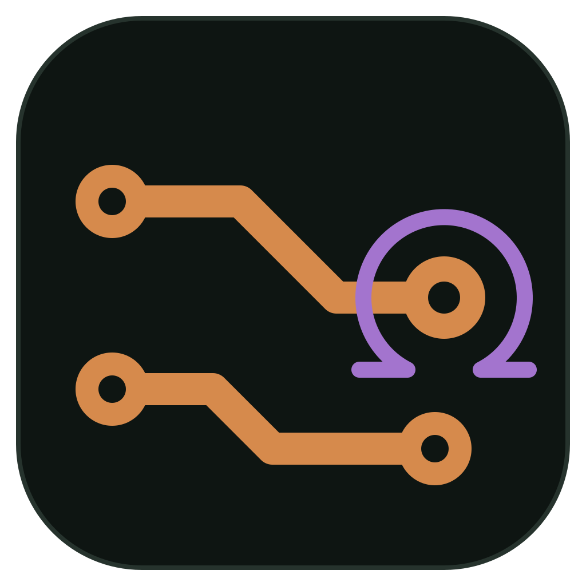
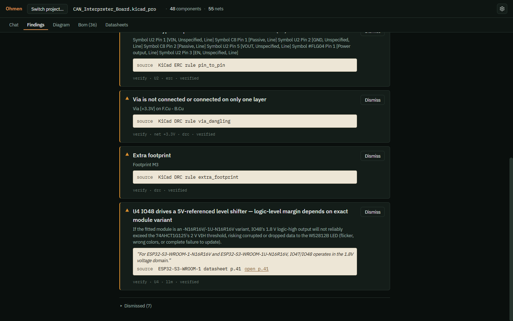
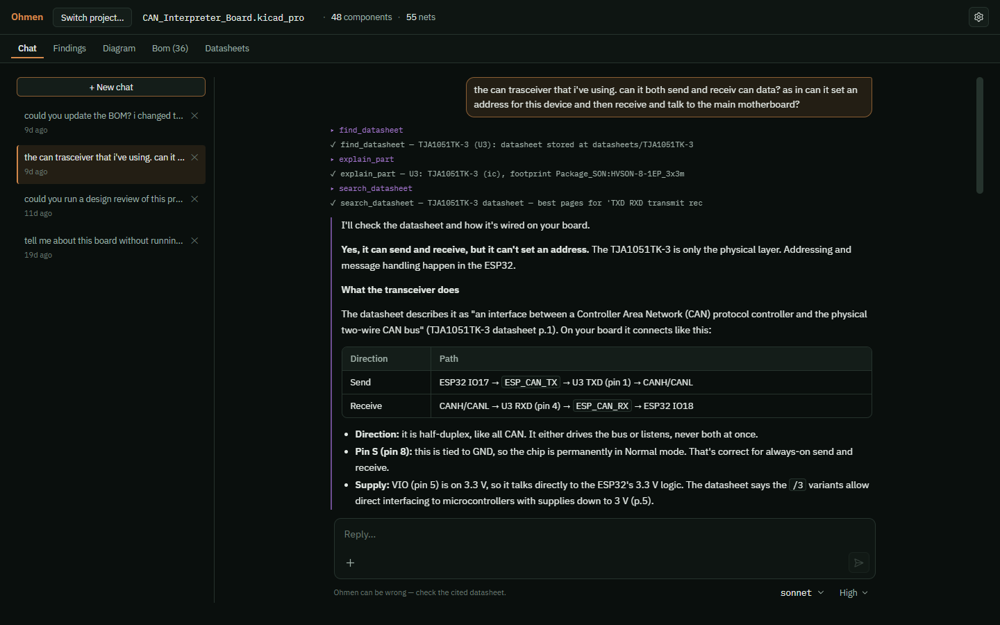
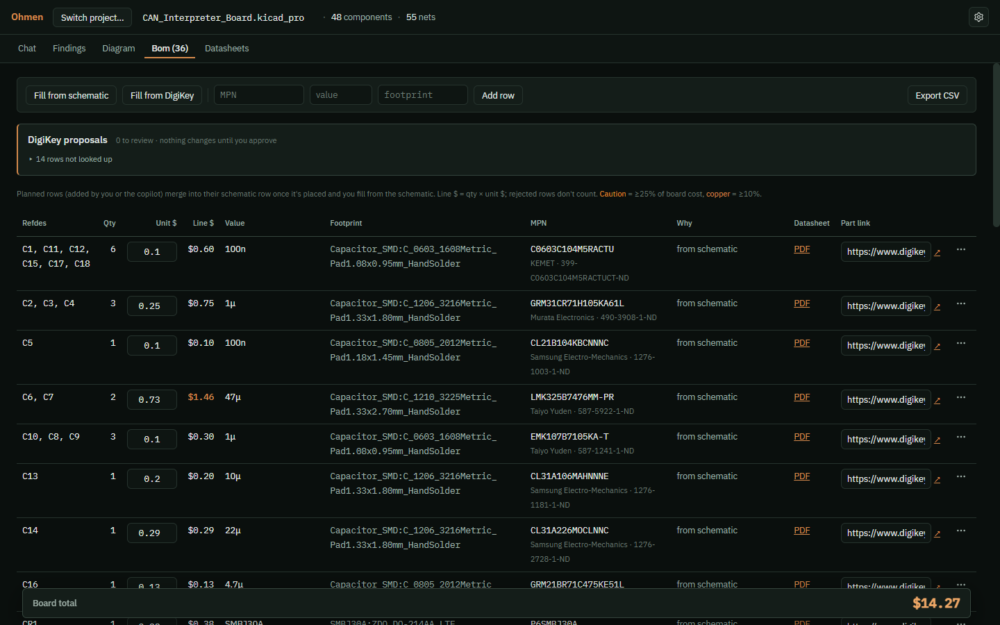
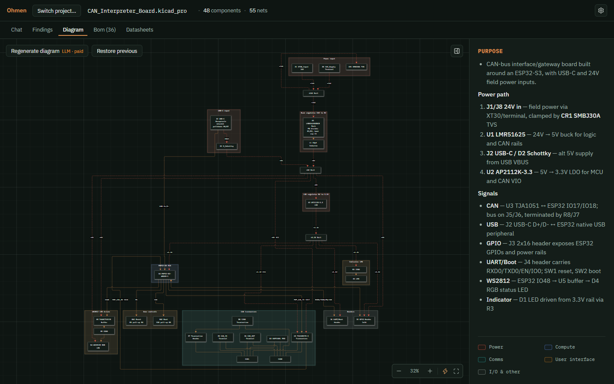
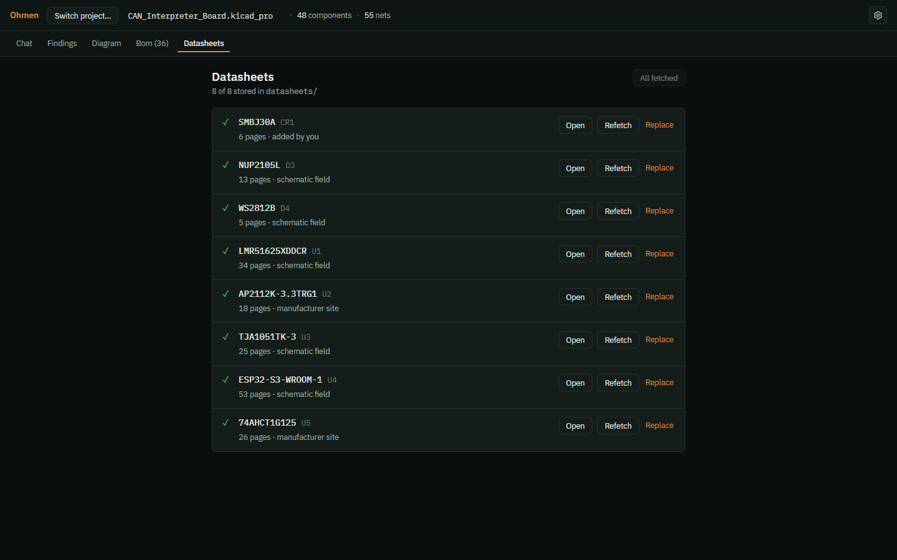

<p align="center">
  
</p>

<h1 align="center">Ohmen</h1>

<p align="center">
  An AI design-review copilot for KiCad. It reads your schematic, checks it against
  real datasheets, and helps you research parts. You stay the author of the board.
</p>

<p align="center">
  <a href="https://github.com/R0mba-Na11avan/Ohmen/releases/latest">Download</a> ·
  <a href="#quick-start">Quick start</a> ·
  <a href="docs/architecture.md">How it works</a> ·
  <a href="CONTRIBUTING.md">Contributing</a>
</p>

<p align="center">
  
</p>

---

A board respin costs weeks and real money, and the mistakes that cause one are
often ones KiCad's ERC can't see: an enable pin left floating, TX and RX crossed,
a part on the wrong rail, a boot strap pulled the wrong way. Ohmen catches
those before you order boards, and shows you the datasheet page that proves each
finding.

**It never edits your design.** It reads the project folder (KiCad can stay open
or closed), and every board-critical claim either cites a source or says it
couldn't verify.

## Features

- **Schematic review.** A free check runs KiCad's ERC/DRC plus a library of
  deterministic, datasheet-cited rules. A deeper review sends a team of AI
  reviewers through each part's datasheet. Findings are ranked must-fix /
  verify / cosmetic, each with its evidence, and you can dismiss what you've
  already judged.
- **A copilot you can talk to.** Ask about your board in chat. The agent can
  run checks, read datasheet pages, edit the BOM and draw diagrams, and shows
  each step as it works.
- **Datasheet library.** Datasheets are fetched automatically into your project
  folder (or drop in your own PDFs), searched, and cited page by page.
- **BOM.** Filled from the schematic, editable by hand or by the agent, with
  optional DigiKey lookups for stock, pricing and lifecycle. Parts you or the
  agent pick before placing them merge into their schematic row once you place
  them, so nothing is counted twice; unclear matches ask you first. Parts marked
  DNP or excluded from the BOM in KiCad stay off it. Exports to CSV.
- **Block diagram.** A diagram of the board's power and signal flow, drawn from
  the netlist.
- **Bring your own model.** Anthropic, Google Gemini, OpenAI, or a local model
  through Ollama, LM Studio or any OpenAI-compatible endpoint. Experimental:
  use a ChatGPT plan through the Codex CLI.

<table>
  <tr>
    <td></td>
    <td></td>
  </tr>
  <tr>
    <td align="center">Chat that reads datasheets and your netlist</td>
    <td align="center">A BOM with prices and part links</td>
  </tr>
  <tr>
    <td></td>
    <td></td>
  </tr>
  <tr>
    <td align="center">A diagram of power and signal flow</td>
    <td align="center">A datasheet library for the project</td>
  </tr>
</table>

## Install

Download the latest build from the
[Releases page](https://github.com/R0mba-Na11avan/Ohmen/releases/latest).
No Python or Node install is needed.

| Platform | File | Notes |
|---|---|---|
| Windows 10/11 (x64) | `Ohmen-<version>-win-x64.exe` | The installer isn't code-signed yet, so Windows SmartScreen will warn you. Click **More info → Run anyway**. |
| Fedora / RHEL | `Ohmen-<version>-linux-x86_64.rpm` | `sudo dnf install ./Ohmen-*.rpm` |
| Debian / Ubuntu | `Ohmen-<version>-linux-amd64.deb` | `sudo apt install ./Ohmen-*.deb` |
| Other Linux | `Ohmen-<version>-linux-x86_64.AppImage` | `chmod +x` it and run. Needs FUSE 2 (`fuse-libs` on Fedora, `libfuse2` on Ubuntu). On Ubuntu 24.04+ prefer the `.deb`. |

Linux builds need glibc 2.35 or newer (Ubuntu 22.04, Debian 12, Fedora 36 or later).
Each release lists SHA-256 checksums in `SHA256SUMS.txt`.

macOS isn't supported yet. The code is cross-platform, but nobody on the
project has a Mac to build and test it. Help is welcome
([CONTRIBUTING.md](CONTRIBUTING.md)).

### Requirements

- **KiCad 9 or newer** (tested with 10), installed normally. Ohmen uses its `kicad-cli` and
  finds it automatically; you can point to it in Settings › General. Flatpak
  KiCad isn't supported yet; use your distribution's package.
- **An AI model** for reviews and chat (the free checks, BOM and datasheet
  library work without one). Any one of:
  - an API key from [Anthropic](https://console.anthropic.com/settings/keys),
    [Google AI Studio](https://aistudio.google.com/apikey) or
    [OpenAI](https://platform.openai.com/api-keys)
  - a local model server ([Ollama](https://ollama.com), [LM Studio](https://lmstudio.ai))
  - a ChatGPT plan, through the [Codex CLI](https://github.com/openai/codex) (experimental)

  Settings › Advanced also has an experimental Claude Code CLI route. It is off by
  default; read Anthropic's terms for your plan before turning it on.
- **Optional:** a free [DigiKey API](https://developer.digikey.com/) app for
  stock and pricing in the BOM.

## Quick start

1. Open Ohmen and connect a model (or skip; you can add one later from
   the gear icon).
2. **Open project** and pick your KiCad project folder (the one with the
   `.kicad_pro`), or create a new one.
3. In **Findings**, click **Check** for the free rule-based pass, then
   **Review** for the AI review.
4. Click a finding to see its evidence: the rule or datasheet page it rests on.
   Open the datasheet at that page to judge it yourself.
5. Ask follow-up questions in **Chat**, fill the **BOM**, or open **Diagram**.

Ohmen writes its working files (chats, BOM, findings, cached datasheet
text) into a `.pcb_assistant/` folder inside your project, and datasheet PDFs
into `datasheets/`. Add `.pcb_assistant/` to your project's `.gitignore` if you
version your board.

## Uninstall

- **Windows:** Settings › Apps › Ohmen › Uninstall. This also removes
  your saved keys and settings.
- **Fedora:** `sudo dnf remove ohmen`. **Debian/Ubuntu:** `sudo apt remove ohmen`.
  **AppImage:** delete the file. On Linux, also delete `~/.config/Ohmen`
  to remove saved keys and settings.

Uninstalling never touches your KiCad projects. To remove what Ohmen
added to a project, delete its `.pcb_assistant/` folder (and `datasheets/` if
you don't want the PDFs).

## Cost and privacy

- **You pay your model provider directly**, at their rates. A full review of a
  typical board makes many model calls (each part's datasheet is read), so
  start with a smaller model and the depth slider at *low* to get a feel for
  cost. Free API tiers with low daily limits usually can't finish a review.
- **What leaves your computer:** your netlist, the datasheet pages being
  discussed and your chat messages go to the model provider you choose. Part
  numbers go to DigiKey and manufacturer sites when fetching datasheets or
  prices. With a local model, design data stays on your machine.
- **Nothing is sent to this project.** There is no telemetry and no account.
- API keys are stored encrypted with your operating system's keychain (DPAPI on
  Windows; GNOME Keyring or KWallet on Linux).

## Important: it can be wrong

Ohmen is an aid to engineering review, not a substitute for it. AI
findings can be wrong or incomplete, and a clean result does not mean a board
will work. Check every finding against its source before acting on it. The
software is provided as-is, without warranty (see [LICENSE](LICENSE)).

## Command line

The review engine also runs without the app:

```bash
pip install -e .
pcb check board.kicad_sch                # free deterministic checks
pcb review board.kicad_sch -m claude:claude-sonnet-5
pcb --help
```

## Development

See [CONTRIBUTING.md](CONTRIBUTING.md) for running from source, tests, and how to
add a review pattern (the easiest first contribution). The architecture is in
[docs/architecture.md](docs/architecture.md).

## License and credits

[MIT](LICENSE). Bundles the [IBM Plex](https://github.com/IBM/plex) fonts (SIL
Open Font License 1.1).

Ohmen is an independent project and is not affiliated with or endorsed by
KiCad. It works with KiCad through its command-line tool.
